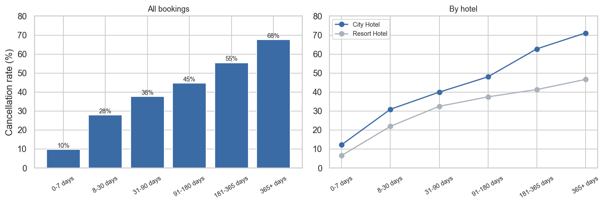
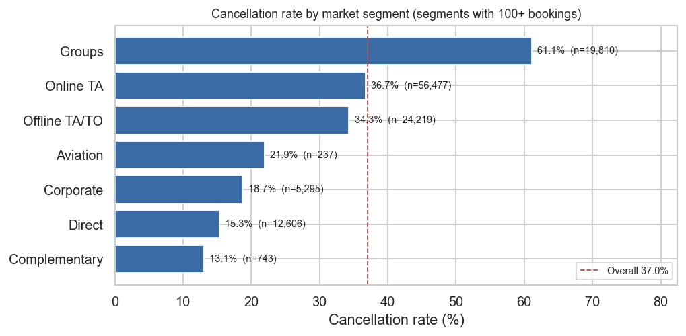
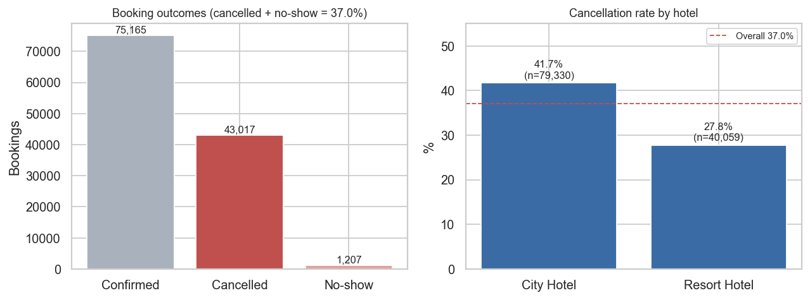
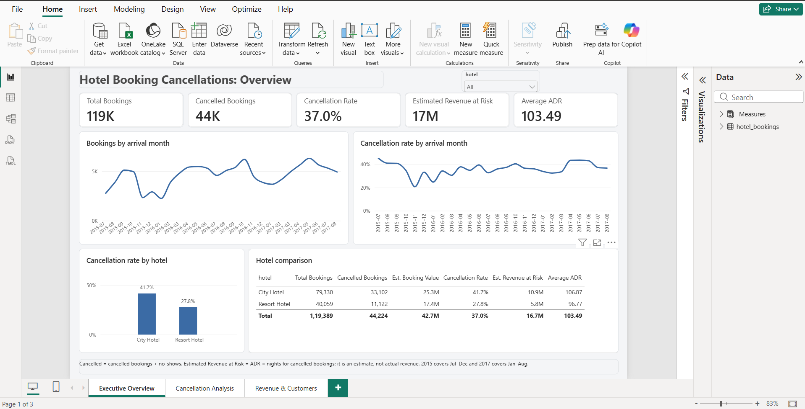
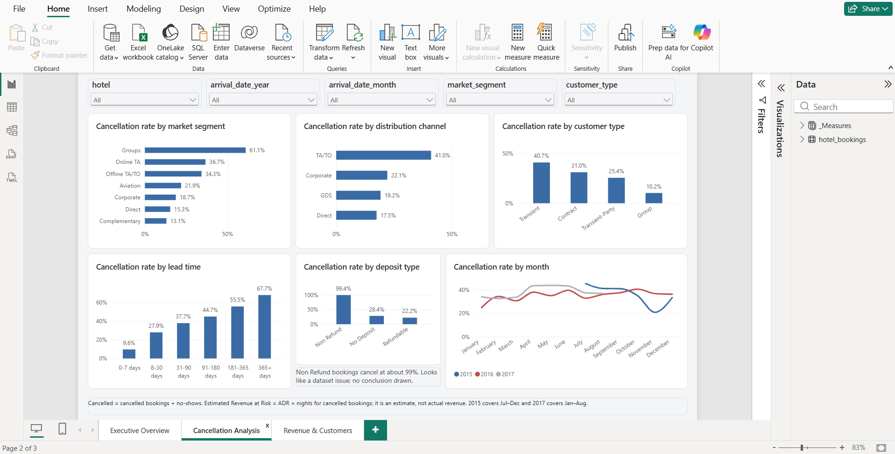
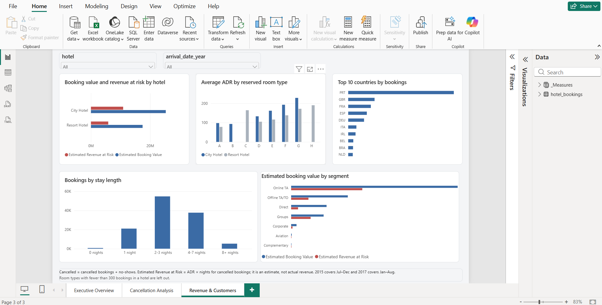

# Hotel Booking Cancellation & Revenue Analytics

I wanted to understand one question properly: **why do hotel bookings get cancelled, and how much does it matter?** I took the public Hotel Booking Demand dataset (119,390 bookings from a city hotel and a resort hotel), cleaned it, analysed it in Python and SQL, and built a Power BI dashboard on top of the cleaned data.

Some of the early results looked too dramatic (a 99% cancellation rate for non-refundable bookings, for example), so I tried to be careful about which findings I trust and which I only report.

The extra notebook (`notebooks/my_extra_analysis.ipynb`) is a question I picked and made a guess about before looking at the data.

## Business problem

A cancelled booking is an empty room the hotel may not be able to resell. I wanted to find out:

- how many bookings get cancelled, and which hotel is worse
- which customers, channels and booking types cancel the most
- whether lead time or deposit type seem to matter
- how much estimated booking value is tied up in cancelled bookings
- what a hotel could do about it

## Objectives

1. Clean the raw data and document every decision, including the awkward ones.
2. Answer the business questions with SQL (20 queries) and Python (11 simple questions in the EDA).
3. Define KPIs clearly, especially "estimated revenue at risk", which is not the same as actual lost revenue.
4. Turn the findings into suggestions, and say which ones I haven't tested.
5. Build a 3-page Power BI dashboard.

## Dataset

- Hotel Booking Demand dataset, `hotel_bookings.csv`: 119,390 rows, 32 columns, one row per booking.
- Two hotels (City Hotel and Resort Hotel), with arrival dates from July 2015 to August 2017.
- No booking ID and no payment data. This matters for two decisions below (duplicates and revenue).
- 2015 only has July to December and 2017 only has January to August, so 2016 is the only full year.

## Tools

Python (pandas, matplotlib, seaborn) in Jupyter, SQLite for the SQL part, Power BI Desktop for the dashboard.

## Data cleaning

Full details with code are in `notebooks/hotel_booking_eda.ipynb`. The main points:

| Issue | What I did |
|---|---|
| 31,994 identical rows (26.8% of the file) | Kept them and flagged them with `is_duplicate_row`. With no booking ID I can't prove they're duplicates; they could be separate identical bookings. If they are real duplicates, the cancellation rate would be about 27.5% instead of 37%. |
| 4 missing `children` | Filled with 0 |
| 488 missing `country` | Labelled `Unknown` |
| Missing `agent` / `company` | Left missing, added `has_agent` / `has_company` flags |
| 1 negative ADR | Removed the row |
| 1 ADR of 5,400 (next highest is 510) | Kept in counts, but its ADR is blank in `adr_clean` so it doesn't distort ADR or value totals |
| 1,959 bookings with ADR = 0 | Kept, flagged with `adr_zero`, left out of average ADR |
| 180 bookings with zero guests, 715 with zero nights | Flagged, not deleted. Zero-night bookings have a value of 0. |
| 16 extreme party sizes (e.g. 55 adults) | Flagged. The ones with 10 to 55 adults are cancelled Group bookings, so I kept them. |
| `Undefined` categories | Renamed `Unknown` |

I also decided **not** to use `reservation_status` as a predictor, since it just restates whether the booking was cancelled. And `is_canceled = 1` includes no-shows (1,207 of the 44,224), so "cancelled" in this project means cancelled or no-show.

The cleaned file is `data/cleaned/hotel_bookings_cleaned.csv` (119,389 rows).

## Exploratory analysis

The notebook answers 11 simple questions one at a time, each with a chart or table and a short note on what I saw:

1. How many bookings are cancelled, and does it differ by hotel?
2. Do cancellations change by month?
3. Which market segment cancels the most?
4. Which distribution channel cancels the most?
5. Does deposit type matter?
6. Which customer type cancels the most?
7. Do bookings made far in advance cancel more?
8. Which countries do the cancellations come from?
9. How much estimated revenue is at risk?
10. How does the average price (ADR) differ by room type?
11. How long do guests stay, and does it matter for cancellations?

A few of the charts:







All figures are in `reports/figures/`.

I also wrote a short separate notebook, `notebooks/my_extra_analysis.ipynb`, on one question I wanted to test myself: do bookings with children cancel less? My guess was yes. The data didn't support it, and the answer changes depending on whether the identical rows are included.

## SQL analysis

20 queries in `sql/hotel_booking_analysis.sql`, going from basic counts to CTEs and window functions (`RANK`, `LAG`, a window over aggregates). Each one answers a business question. The queries, their results and my interpretation are written up in `reports/sql_analysis.md`. I checked that the SQL totals match the pandas totals, and that the main rates (hotel, segment, channel, deposit type, lead time) match the notebook.

## KPIs

Defined in `reports/kpi_definitions.md`. A few headline values (all rows kept):

| KPI | Value |
|---|---|
| Total bookings | 119,389 |
| Cancelled bookings (incl. no-shows) | 44,224 |
| Cancellation rate | 37.04% |
| Average ADR (zero-ADR rows excluded) | 103.49 |
| Average lead time | 104.0 days |
| Estimated booking value | about 42.7 million |
| Estimated revenue at risk | about 16.7 million (39.1% of the value) |

**On "revenue at risk":** it's ADR x nights for cancelled bookings. It's an estimate of the value attached to cancellations, not money the hotel actually lost. The data has no payments, refunds, cancellation fees, or information on whether cancelled rooms were resold. The currency isn't stated either.

## Dashboard

A 3-page Power BI report built on the cleaned CSV (`powerbi/hotel_booking_dashboard.pbix`):

1. **Executive overview**: bookings, cancellation rate, estimated revenue at risk, average ADR, trends by arrival month and a hotel comparison table.
2. **Cancellation analysis**: cancellation rate by segment, channel, customer type, lead time, deposit type and month, with slicers for hotel, year, month, segment and customer type.
3. **Revenue and customers**: estimated booking value and revenue at risk by hotel and by segment, average ADR by room type, top 10 countries and bookings by stay length.







What I built on each page, the data model and every DAX measure are in `powerbi/POWERBI_BUILD_GUIDE.md`.

## Key findings

- **Lead time:** cancellations rise from 9.6% (booked 0–7 days ahead) to 67.7% (more than a year ahead).
- **Channel:** Online TA has 20,739 cancelled bookings, about 61% of the estimated revenue at risk.
- **Hotel:** City Hotel cancels 41.7% of bookings against 27.8% at Resort Hotel.
- **Country:** Portugal is about 41% of bookings and 62% of cancellations.
- **Stay length:** 2–3 night stays have the highest rate, 43.0%.

Two cautions: Non Refund deposits show a 99.4% cancellation rate, which looks like a data quirk, so I made no recommendation from it. The identical rows could also shift these numbers. Details are in [reports/business_insights.md](reports/business_insights.md).

## Suggestions

Three ideas, none of them tested. They are in notebook Section 7 and [reports/business_insights.md](reports/business_insights.md). The main one is to look at long-lead-time bookings, since cancellations rise steeply with lead time.

## Limitations

- The data has no costs, no guest IDs and covers only 2015–2017, with 2016 the only full year. Revenue figures are estimates (ADR × nights), not actual income.
- 31,994 rows are identical to another row. I kept them and flagged them, so the rates may be affected. I did not test how much.
- Everything here shows association, not cause.

Full list: notebook Section 7 and [reports/business_insights.md](reports/business_insights.md).

## Problems I ran into

- Power BI first loaded the wrong CSV, so the numbers didn't match the notebook. I re-imported the cleaned file and checked the cards against the notebook totals.
- My project folder was nested inside another folder under OneDrive, which broke the relative file paths (`../data/...`). I fixed the folder layout.
- `pip install` gave a launcher error. Running it as `python -m pip install -r requirements.txt` worked.
- Months and year-months sorted alphabetically in the charts. I fixed it with "Sort by column" (`arrival_month_num`).
- I got `NameError: name 'raw' is not defined` when I ran cells out of order. Kernel, Restart & Run All fixed it.
- Visuals and slicers on the dashboard pages were different sizes, so I set exact sizes and positions and a 1280 x 720 canvas.
## How to run

```bash
git clone https://github.com/Tanaya186Joshi/Hotel-Booking-Analytics.git
cd Hotel-Booking-Analytics
pip install -r requirements.txt
jupyter notebook notebooks/hotel_booking_eda.ipynb
```

Use Kernel → Restart & Run All. The notebook builds the SQLite database itself; the SQL queries and how to open them are in [reports/sql_analysis.md](reports/sql_analysis.md).

## Opening the database
Running the notebook recreates `data/cleaned/hotel_bookings_cleaned.csv`, the figures in `reports/figures/`, and `data/cleaned/hotel_bookings.db` (SQLite). Then open the database in DB Browser for SQLite (or run `sqlite3 data/cleaned/hotel_bookings.db < sql/hotel_booking_analysis.sql`) to run the SQL queries. `notebooks/my_extra_analysis.ipynb` needs the cleaned CSV, so run the main notebook first. For the dashboard, open `powerbi/hotel_booking_dashboard.pbix`, or follow `powerbi/POWERBI_BUILD_GUIDE.md` to rebuild it.

## Project structure

```
Hotel-Booking-Analytics/
├── data/
│   ├── raw/hotel_bookings.csv              (unchanged)
│   └── cleaned/hotel_bookings_cleaned.csv
├── notebooks/
│   ├── hotel_booking_eda.ipynb
│   └── my_extra_analysis.ipynb
├── sql/hotel_booking_analysis.sql
├── powerbi/
│   ├── POWERBI_BUILD_GUIDE.md              (model, DAX, what is on each page, checks)
│   ├── hotel_theme.json
│   ├── hotel_booking_dashboard.pbix
│   └── screenshots/                        (page1.png, page2.png, page3.png)
├── reports/
│   ├── business_insights.md
│   ├── sql_analysis.md
│   ├── kpi_definitions.md
│   ├── data_dictionary.md
│   ├── interview_prep.md
│   └── figures/
├── README.md
└── requirements.txt
```
